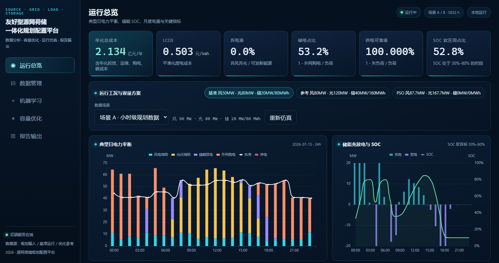

<<<<<<< HEAD
# Source-Grid-Load-Storage-Intergrated-Simulation-Platform
源网荷储一体化仿真平台
=======
# 友好型源网荷储一体化规划配置仿真平台

数据分析 + 容量优化 + 运行仿真 + Vue3 可视化 + FastAPI 后端。项目读取小时级源荷气象与电价数据，完成数据体检、逐时调度仿真、PSO/GWO 容量优化、机器学习对照和可打印报告。

当前状态：方案 v3 + 模型口径 v1 已定稿；已完成工程骨架、CSV 上传体检、场景 A/B 数据加载、规则调度仿真器、PSO/GWO 容量优化、FastAPI 接口、SQLite 运行记录、Vue3 前端与可打印报告；新增“公开光伏数据训练 → 03 数据迁移”的机器学习对照页。详细方案见 [docs/方案\_实验九.md](docs/方案_实验九.md)，建模口径见 [docs/模型口径.md](docs/模型口径.md)，计算结果见 [docs/计算结果\_v1.md](docs/计算结果_v1.md)，机器学习见 [docs/机器学习.md](docs/机器学习.md)。

答辩材料：

* [docs/答辩说明.md](docs/答辩说明.md)：8–10 分钟口播稿、结果口径、常见问答。
* [docs/项目实现说明.md](docs/项目实现说明.md)：技术栈、数据流、模型公式、算法、API、前端、数据库、部署。
* [docs/项目展示说明.md](docs/项目展示说明.md)：启动步骤、五页操作、预期数值。

## 界面



运行总览 / 数据管理 / 机器学习 / 容量优化 / 报告输出五页截图在 `docs/screenshots/`。

## 机器学习

要求是“选用网络上的数据集，训练一份机器学习，再用这个去分析给出的数据”。当前实现：

* 外部数据：Kaggle **Solar Power Generation Data**（Plant 1，33 天，15 分钟级，3,157 个聚合点）；原始 CSV 不纳入仓库，`scripts/prepare_external_solar.py` 可重新下载。
* 模型：随机森林回归，输入辐照度、气温、时刻周期特征，输出光伏容量因子 CF；按日期前 80%/后 20% 时序切分。
* 外部测试集：MAE 0.0077、RMSE 0.0156、R² 0.9964。
* 迁移到 03：ML CF 均值 0.269，物理 CF 均值 0.234，两条曲线相关系数 0.9997。
* 基准方案对照：年化成本 2.134 → 1.964 亿元，LCOE 0.503 → 0.463 元/kWh，绿电占比 53.2% → 55.8%，弃电率均为 0。
* 结论：作为跨区域迁移的敏感性分析；外部数据仅 33 天、位于印度，存在域偏移，物理口径仍是主结果。

复现：

```powershell
python scripts/prepare_external_solar.py
python -m src.ml.pv --train
```

详见 [docs/机器学习.md](docs/机器学习.md) 与 `notebooks/02_机器学习光伏迁移.ipynb`。

## 版本

* 模型口径 v1（当前，优先）：`docs/模型口径.md`
* 方案 v3：`docs/方案_实验九.md`
* 方案 v1（归档，第一版参考）：`../方案_实验九_v1.md`

## 数据

项目数据包位于 `data/raw/源网荷储一体化仿真数据/`：

* `03\_小时级源荷气象电价数据.csv`：主输入，5832 行（2026-01-01 至 08-31，小时级）。
* `05\_风光负荷同步出力数据.csv`：基准方案运行结果，用作对照。
* `06\_容量优化与评价结果.xlsx`：优化参考（80/120/40/160/70 MW）。
* `01/02/07/08`：项目、设备、电价、成本参数。
* `04`：15 分钟典型日样例；`09` 为草稿，仅参考；`10` 为数据说明。

注意：数据文件之间存在版本/口径差异，平台会做“体检 + 冲突提示”，不会静默合并。详见方案第 2 节。

## 快速启动

```powershell
# 1. 安装后端依赖（Anaconda 环境）
E:\Anaconda\python.exe -m pip install -r requirements.txt

# 2. 构建前端（首次或改前端后）
cd frontend
npm install
npm run build
cd ..

# 3. 启动本机演示（后端同时托管 frontend/dist）
powershell -ExecutionPolicy Bypass -File deploy\start.ps1

# 健康检查
# http://127.0.0.1:8000/api/health
# 平台首页
# http://127.0.0.1:8000/
```

开发时前端热重载：

```powershell
# 终端 1：后端
powershell -ExecutionPolicy Bypass -File deploy\start.ps1 -Reload

# 终端 2：Vite dev server（/api 代理到 8000）
cd frontend
npm run dev
# http://127.0.0.1:5173
```

测试：

```powershell
.\.venv\Scripts\python.exe -m pytest tests -q -p no:cacheprovider
```

### 服务器部署（可选，本机未验证 Docker）

本机演示不依赖 Docker。服务器上有 Docker 时：

```bash
docker compose up -d --build
# http://<服务器IP>:8000/
```

`Dockerfile` 先构建前端，再由 FastAPI 托管 `frontend/dist`；SQLite 文件在容器内 `data/platform.sqlite3`，如需持久化可给 `data/` 挂卷。

## 计算原型

```powershell
# 场景 A（03 规划数据）PSO
.\.venv\Scripts\python.exe -m src.optimize --scenario A --algo pso --particles 20 --iters 20

# 场景 A GWO
.\.venv\Scripts\python.exe -m src.optimize --scenario A --algo gwo --particles 20 --iters 20

# 场景 B（05 基准运行）对照
.\.venv\Scripts\python.exe -m src.optimize --scenario B --algo pso --particles 20 --iters 20
```

结果写入 `data/output/opt_<scenario>_<algo>.json`。

当前原型发现：在“成本优先 + 小权重弃电/SOC 惩罚”的口径下，场景 A 的 PSO 最优为零储能（年化约 1.68 亿元），说明现有数据下储能不经济。储能 40 MW/160 MWh 等配置作为政策/低碳对照；详见 `docs/模型口径.md` 第 11 节。

## 已实现接口

* `GET /api/health`：服务状态、项目名、数据包检测。
* `GET /api/meta`：项目参数。
* `GET /api/scenarios`：场景 A/B 元数据、小时数、数据来源。
* `POST /api/simulate`：给定容量跑规则调度，返回年化成本、LCOE、弃电、SOC 等指标；`keep_series=true` 时返回全时序。
* `POST /api/optimize`：PSO/GWO 在线容量优化，参数 `scenario/algorithm/particles/iters/seed`，结果写入 SQLite 并返回 `run_id`。
* `GET /api/runs`：最近优化运行摘要（SQLite）。
* `GET /api/reference`：预计算 PSO 30×30 参考解，用于前端对照。
* `GET /api/ml/pv`：外部光伏模型信息、训练集/测试集指标。
* `GET /api/ml/pv/compare`：03 全时序的物理 CF / ML CF / GHI / 温度对照。
* `POST /api/simulate` 的 `pv_model="ml"`：用外部模型曲线重跑规则调度（仅场景 A）。
* `POST /api/datasets/inspect`：上传 CSV/XLSX，返回时间轴、缺失、重复、异常、物理范围、评分、可用性。

前端页面：运行总览、数据管理（上传体检/列映射/预览）、机器学习（模型来源/典型日对照/误差分布/仿真对比）、容量优化（参数、收敛曲线、运行记录）、报告输出（章节选择、HTML 下载、打印为 PDF）。

仿真示例：

```powershell
curl.exe -X POST http://127.0.0.1:8000/api/simulate `
  -H "Content-Type: application/json" `
  -d "{\"scenario\":\"A\",\"C_w\":50,\"C_pv\":80,\"C_b\":20,\"E_b\":80}"
```

体检示例（PowerShell）：

```powershell
curl.exe -X POST http://127.0.0.1:8000/api/datasets/inspect `
  -F "file=@data/raw/源网荷储一体化仿真数据/03\_小时级源荷气象电价数据.csv"
```

## 目录

```
backend/    FastAPI 接口与静态前端托管
src/        数据加载、清洗、仿真、优化、SQLite、机器学习
notebooks/  数据分析过程（01 数据体检与场景对比，02 机器学习光伏迁移）
frontend/   Vue3 + Vite + ECharts 前端
data/       处理数据、平台 SQLite、优化结果、外部训练数据
models/     训练好的光伏容量因子模型与元数据
deploy/     本机启动与 Docker
docs/       方案、模型口径、计算结果、机器学习、报告
```

## 说明

* 本机演示不依赖 Docker；Docker 仅用于服务器部署（`Dockerfile` 未在本机验证）。
* 机器学习使用公开光伏数据训练的随机森林模型，作为 03 数据的迁移对照；主流程仍是规则仿真 + PSO/GWO。
* 测试命令当前为 **27 passed**（quality 4 + simulate 5 + optimize 4 + API 10 + ML 4）。
>>>>>>> d847b44 (feat: 源网荷储一体化规划配置仿真平台)
